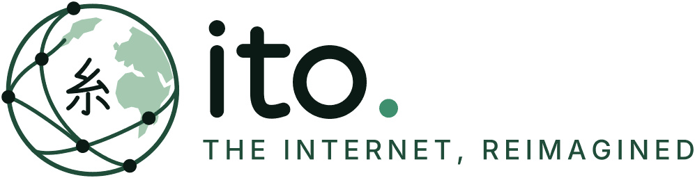

# ito brand and visual identity

**Status:** the reference for every ito surface. **Consistent branding is a permanent product
principle** ([vision](vision.md), principle 3; [CLAUDE.md](../CLAUDE.md)). Changes to anything
here need the maintainer's approval and must keep the accessibility and resource rules below.

> **Brand kit reference (19 Nov 2026).** The original `ito-brand-kit/BRAND.md` and its
> `references/03-flat-emblem.png` and `references/02-preferred-brand.png` take precedence over
> the current generated logo. The generated globe-with-thread artwork is **not approved**.
>
> **Provisional artwork (21 Nov 2026).** The name **ito** is decided ([ADR 0025](adr/0025-rename-to-ito.md)).
> The mark is a vector interpretation of the "thread around the earth" idea, carried over from the
> first proposal (PR #12), and is **pending visual review**. Until it is approved, treat the
> shapes as replaceable: the masters below can be redrawn and every asset regenerated in one step.

<p>
  <picture>
    <source media="(prefers-color-scheme: dark)" srcset="../branding/png/logo-full-dark.png">
    
  </picture>
</p>

## 1. Identity

| | |
|---|---|
| Name | **ito**: always lower case, also at the start of a sentence and in titles. Never "Ito" or "ITO" |
| Former name | MeshBeacon. Identifiers keep it (app slug, integration domain, discovery service, Python package, data paths); see ADR 0025. Not affiliated with the unrelated MeshBeacon disaster-response project (meshbeacon.org) |
| Tagline | **The internet, reimagined.** (full stop in running text; set in capitals without the full stop in the logo lockup) |
| Website | [ito.earth](https://ito.earth) |
| Personality | Calm, clear, practical, privacy-first, technically capable |
| Design language | Clean, minimal, professional, understated. Subtle borders, restrained shadows, generous spacing. **No** heavy gradients, glows, decorative animation or clutter |
| Relationship to Home Assistant | Complements it. Inside Home Assistant, ito follows the user's theme for surfaces and text, and brings its own accent, status colours, mark and typography |
| Tone | UK English, short direct sentences, plain language and precise privacy claims. Reticulum and LXMF are always named correctly |

## 2. Logo

The mark is a thread encircling the earth: a globe with a meridian pair and three parallels, and
a sage thread across it that ends in a node.

| Asset | Use | Files |
|---|---|---|
| Full logo (mark, wordmark, tagline) | README, documentation headers, release notes | `branding/svg/logo-full-{light,dark}.svg`, `branding/png/logo-full-*.png` |
| Horizontal logo (mark + wordmark) | Page headers, the integration's brand logo | `branding/svg/logo-horizontal-{light,dark,mono-light,mono-dark}.svg` |
| Logo badge | Home Assistant app `logo.png`: legible on light and dark app pages | `branding/svg/logo-badge-dark.svg` → `meshbeacon/logo.png` (250 × 100) |
| Mark | Inside the interface; the integration's brand icon | `branding/svg/mark-{light,dark,mono-light,mono-dark}.svg` |
| App icon (mark on a rounded tile) | App store, launchers, social previews | `branding/svg/icon-{dark,light,mono-dark,mono-light}.svg`, PNG at 128/256/512 |
| Small-format mark and icon (16–48 px) | Favicons, the interface header | `branding/svg/mark-small-*.svg`, `icon-small-*.svg`, `favicon.svg`, `favicon-{16,32,64}.png` |

**Variants:** *dark* for dark backgrounds, *light* for light backgrounds, *mono-dark* (mist) and
*mono-light* (deep green) for single-colour use such as print or embossing.

**Rules**
- Use the supplied files. Do not redraw, recolour outside the palette, stretch, rotate, add
  effects or outlines, or set the wordmark in another typeface or in capitals.
- Clear space around the logo is at least the node's diameter. Do not place the logo on busy
  images.
- Minimum sizes: the full mark at 48 px or more; below that, use the small-format mark. The
  horizontal logo at 24 px high or more; the full logo with tagline at 64 px high or more.
- The light variant goes on pale backgrounds (mist, white); the dark variant on dark ones.

**Source of truth:** the master SVGs in `branding/src/`:
- `mark.svg`, `mark-small.svg`: geometry only, coloured through classes;
- `wordmark.svg`, `tagline.svg`: Inter outlined to paths by `tools/brand/outline_wordmark.py`.

`tools/brand/build.py` recolours and composes the variants, writes the interface's mark data
(`frontend/brand-mark.js`) and renders every PNG. `tools/brand/build.py --check` (run by
`tests/unit/test_branding.py`) fails if anything generated is out of date. PNGs are quantised and
optimised (all 34 together are under 400 KB).

```sh
python3 tools/brand/build.py          # needs Node + Playwright's Chromium to render PNGs
python3 tools/brand/build.py --check  # standard library only
```

## 3. Colour

### 3.1 Brand palette

| Purpose | Name | Hex |
|---|---|---|
| Dark background and brand ink | Forest | `#0B1A14` |
| Secondary surfaces and accessible accent on light surfaces | Deep Moss | `#1F4D3A` |
| Secondary accent | Leaf | `#3E8F6E` |
| Accent on dark surfaces; the thread in the mark | Sage | `#A6C9B2` |
| Pale brand background (logo tile, theme background) | Mist | `#E8F3ED` |
| Information and charts | Sky blue | `#0EA5E9` |
| Success / online | Emerald green | `#10B981` |
| Warning | Amber | `#F59E0B` |
| Error / offline | Red | `#EF4444` |
| Dark background | Forest | `#0B1A14` |
| Light background | Mist | `#E8F3ED` |
| Dark text | Forest | `#0B1A14` |
| Light text | Off-white | `#F8FAFC` |

Artwork only: forest `#17302A` (dark tiles) and leaf `#496A5D` (the tagline on light
backgrounds). Data-only colours for charts (never for status): violet `#7C3AED` (light) and
`#A78BFA` (dark) as the second series. Sage is too pale for text or indicators on light surfaces
(about 1.7:1 on white), so it is used there only as the decorative thread.

### 3.2 Accessible variants

Text uses deeper or lighter shades of each hue to reach WCAG 2.2 AA (4.5:1 for text, 3:1 for
indicators). These are design tokens, not extra brand colours.

| Token | Light theme | Dark theme | Use |
|---|---|---|---|
| `accent` | `#284C40` | `#A6C9B2` | Focus rings, active tab bar, buttons, message tints |
| `accent-text` | `#284C40` | `#A6C9B2` | Links, active tab label, the header wordmark, the mark's globe |
| `good` / `good-text` | `#059669` / `#047857` | `#10B981` / `#34D399` | Online, connected, no problems |
| `warn` / `warn-text` | `#D97706` / `#B45309` | `#F59E0B` / `#FBBF24` | Partly connected, attention |
| `bad` / `bad-text` | `#DC2626` / `#B91C1C` | `#EF4444` / `#F87171` | Offline, problem, not connected |
| `info` / `info-text` | `#0284C7` / `#0369A1` | `#0EA5E9` / `#38BDF8` | Neutral information (transport enabled) |
| `neutral` / `neutral-text` | `#64748B` / `#475569` | `#64748B` / `#94A3B8` | Isolated, unknown, unavailable |
| `series-1` / `series-2` | `#0284C7` / `#7C3AED` | `#0EA5E9` / `#A78BFA` | Chart series (receive / send) |

`tests/frontend/tokens.test.mjs` checks every pair on the brand surfaces **and** on Home
Assistant's default light and dark surfaces.

## 4. Typography

**Inter**, with the system sans-serif stack as fallback:
`"MeshBeacon Inter", Inter, var(--ha-font-family-body), system-ui, -apple-system, "Segoe UI", Roboto, sans-serif`.

| Weight | Use |
|---|---|
| Regular 400 | Body text |
| Medium 500 | Labels, navigation, units |
| Semibold 600 | Headings, the header wordmark |
| Bold 700 | Prominent statistics, the logo wordmark |

- **Bundled, never fetched.** Inter 5.3.0 (Latin subset, WOFF2, about 97 KB for four weights) ships
  in `custom_components/meshbeacon/frontend/fonts/inter-5.3.0/` with its **SIL Open Font
  License 1.1** (`OFL.txt`; also `branding/fonts/OFL.txt` and `THIRD_PARTY_NOTICES`).
- It is registered under the private family name "MeshBeacon Inter", so Home Assistant's own
  typography is untouched. It is loaded only when the panel opens.
- Figures use tabular numerals. Sentence case for headings and labels.

## 5. Iconography

| Surface | Icon |
|---|---|
| Home Assistant sidebar (integration panel now; Ingress `panel_icon` if ADR 0013 is approved) | **`mdi:earth`**: Home Assistant accepts only Material Design Icons here, and a globe is the closest to the mark. No custom-icon workaround is used |
| Status sensor | `mdi:earth`; the other entities keep their descriptive MDI icons (`icons.json`) |
| App store and app page | `meshbeacon/icon.png` (128 × 128) and `meshbeacon/logo.png` (250 × 100). These are the Supervisor's documented names and sizes; no dark variants are documented for apps, so both sit on their own forest-green tile |
| Integration (Settings → Devices & services, HACS) | Local brand images in `custom_components/meshbeacon/brand/` (Home Assistant 2026.3 and later): `icon.png` 256, `icon@2x.png` 512, `logo.png` and `logo@2x.png` (shortest side 128 / 256), and `dark_` variants. Verified against Home Assistant 2026.10.4's `components/brands` (allowed names and fallbacks) and served in tests |
| Inside the interface | MDI icons from Home Assistant (`ha-icon`) for figures; the ito mark in the header and in empty and error states; status shapes (tick, exclamation, cross, dash, question mark) next to colour |

## 6. Interface design system

### 6.1 Tokens

Code layout (see [architecture §6a](architecture.md)): `ui/components.js` (the components
below), `ui/views.js` (Overview, Diagnostics), `ui/controller.js` (tabs, history, rendering),
`ui/style.js` (styles). The same modules serve every delivery.

`custom_components/meshbeacon/frontend/tokens.js` is the single source for the interface. Views
use only `--mb-*` custom properties, never raw values. A test fails if a view uses a variable
that the tokens do not define.

| Group | Tokens |
|---|---|
| Surfaces | `bg`, `surface`, `line`, `text`, `muted`. **Inside Home Assistant these follow the user's theme** (`--primary-background-color`, `--card-background-color`, `--divider-color`, `--primary-text-color`, `--secondary-text-color`); the brand values are the fallbacks |
| Accent and status | Section 3.2 (always ito's) |
| Type | `--mb-font`; weights 400/500/600/700 |
| Space | `--mb-space-xs` 4, `sm` 8, `md` 12, `lg` 16, `xl` 24, `xxl` 32 (px) |
| Shape | `--mb-radius-sm` 8, `md` 12 (cards), `lg` 16, `pill` |
| Elevation | Cards: 1 px `line` border and a 1 px, 4 % shadow. Nothing heavier |

**Theme:** the panel takes Home Assistant's own light or dark choice (`hass.themes.darkMode`);
without it (preview, a future built-in interface), the device's `prefers-color-scheme`.

### 6.2 Components

| Component | Pattern | Accessibility |
|---|---|---|
| App header | Mark (32 px) + "ito" wordmark in Bold, accent text; the Home Assistant menu button on narrow screens; an app picker only if there are several | `h1`; mark hidden from screen readers |
| Navigation | Text tabs, accent underline for the current tab; route `/meshbeacon/<tab>` | `role="tablist"`, `aria-selected`, 44 px targets |
| Status hero | Card with a coloured left edge, a status mark (shape + colour), the state in words, an explanation and chips | Status text plus shape; `role="img"` with a label |
| Chip | Tinted pill with a dot and words | Text always present |
| Stat tile | Label (Medium 13 px) above a large figure (Bold 34 px) and unit (Medium 16 px) | Dash for unknown, never zero |
| Chart card | Title, legend with current or hovered values, SVG area/line chart, axis labels, range control | Text summary as `aria-label`; legend readable without hover |
| Peer card | Name, status chip, facts list; coloured left edge | Status in words |
| Banner | Problem or unavailable notice, coloured edge, plain-language next step | `role="status"` |
| Empty, error, loading | Centred card with the mark, a heading, one sentence and at most one button; loading uses quiet pulsing skeletons | `role="alert"` for errors; `aria-busy` while loading; no motion with reduced motion |
| Conversation list (M5) | Rows with an initials avatar (accent tint), name, one-line preview, time and an unread badge (accent pill); the open conversation is tinted | Each row a button with `aria-current`; badge has an `aria-label` ("3 unread") |
| Message bubble (M5) | Incoming: neutral tint, left; outgoing: accent tint, right; time and delivery state in words below (tone colour plus words, a double tick only for Delivered); automatic replies italic with a label | Text only as text (`pre-wrap`); state never by colour alone; log is `role="log"` |
| Composer (M5) | Growing textarea and a pill **Send** button; plain-language note when sending is unavailable; byte count only near the limit | Labelled; Enter sends, Shift+Enter new line; errors `role="alert"` |
| Quiet button | Outlined pill in accent text (Add contact, Copy, Send again) | 36 px minimum height |

New features (LXMF messaging, I2P, LoRa) add views made of these components and tokens. A new
pattern is added here first, in the same change.

### 6.3 Layout

- Content up to 1280 px wide, 16 px padding on phones and 24 px from 870 px.
- Tiles: two columns on phones; four on desktops.
- Messages: two columns from 870 px (conversations 280–360 px, then the conversation); below it
  the list, and one conversation full width with a Back button.
- Charts: one column below 900 px; traffic full width with processor and memory side by side
  above it. No horizontal scrolling at 320 px.

## 7. Accessibility requirements (WCAG 2.2 AA)

- Contrast: text ≥ 4.5:1, indicators and chart lines ≥ 3:1, in both themes (automated, §3.2).
- Never colour alone: every status has words, and the hero adds a shape.
- Keyboard: every control reachable, visible focus (2 px accent outline), targets ≥ 24 × 24 px
  (most are 44 px).
- Reduced motion: no animation when `prefers-reduced-motion: reduce`. There are no decorative
  animations at any time.
- Structure: one `h1`, headings in order, landmarks, labelled charts and groups.
- Checked with axe-core (WCAG 2.0/2.1/2.2 A and AA rules) on every preview scenario, in both
  themes, at 390, 820 and 1280 px: **no violations** (18 Nov 2026; including content inside
  the panel's shadow root).

## 8. Performance and privacy rules

- No external fonts, CDNs, analytics or tracking. Images in documentation are repository files
  (no hot-linked images in the app's own `DOCS.md`, which Home Assistant renders locally).
- No frontend dependencies. The build tools (Node, Playwright, fontTools for re-outlining) are
  developer tools only.
- Assets are optimised: 34 PNGs under 400 KB in total; four font files about 97 KB, loaded only
  when the panel opens.
- No new permissions or endpoints. The integration's brand images are served by Home Assistant's
  own brands API.

## 9. Where the brand appears

| Surface | Status |
|---|---|
| Home Assistant app store and app page | `meshbeacon/icon.png`, `logo.png`; description = the tagline |
| Sidebar entry | `mdi:lighthouse-on`, title "MeshBeacon" |
| Integration panel (current) and built-in Ingress interface (ADR 0013, proposed) | Same tokens, components and assets. The panel code moves into the app if ADR 0013 is approved |
| Optional integration | Brand images; status icon |
| README, installation docs, user guides | Logo header (light/dark `<picture>`), tagline |
| Example dashboard | Title "MeshBeacon", icon `mdi:lighthouse-on` |
| Release notes | [Release notes template](releasing.md) |
