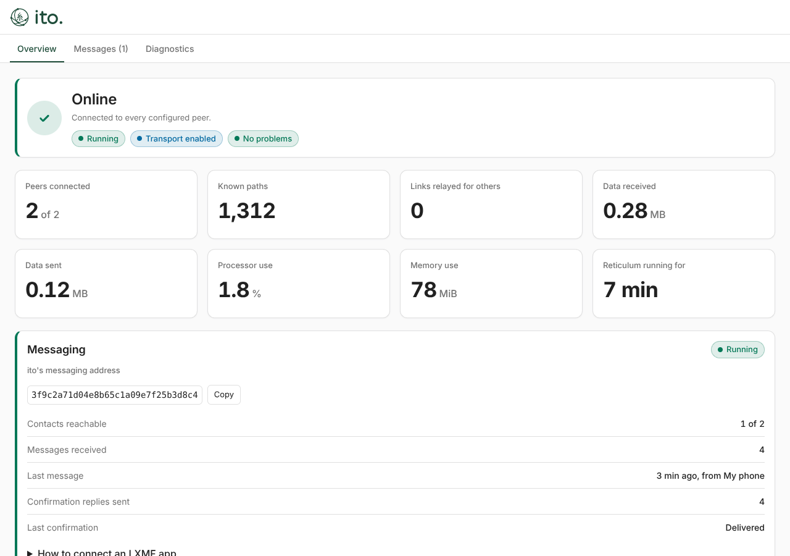
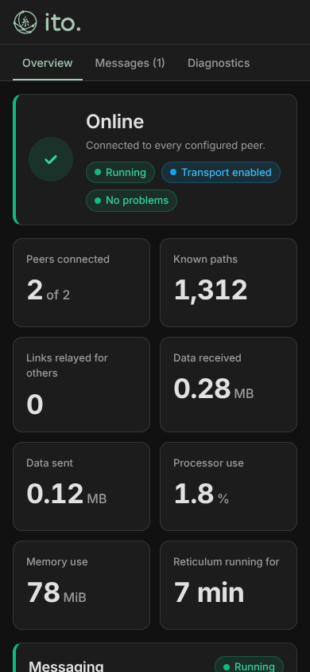

<picture>
  <source media="(prefers-color-scheme: dark)" srcset="../branding/png/logo-horizontal-dark.png">
  
</picture>

# Home Assistant integration (v0.2)

Status: **in development** on `feature/v0.2.0-observability` (draft PR #3). Not published. From v0.3 the
integration installs from Home Assistant's built-in Marketplace ([Marketplace](marketplace.md),
[getting started](getting-started.md)); nothing is published until the first release. Design and security review: [v0.2 feasibility, architecture and security](research/v0.2-observability.md),
[ADR 0006](adr/0006-local-metrics-api.md). Hardware test: [v0.2 hardware acceptance](testing/v0.2-hardware-acceptance.md).

## What it is

A custom integration (`custom_components/meshbeacon`) that shows the ito app's status as
Home Assistant entities and, since 0.4.0, lets administrators read and send LXMF messages in the
panel's **Messages** tab (see below). Status is read-only. History and long-term statistics come from Home Assistant's own
recorder; ito keeps none. Nothing leaves your Home Assistant installation, and Home
Assistant cannot control the node through it.

## Set-up

1. **Install the integration once**, from Home Assistant's Marketplace (Home Assistant 2026.11 or
   newer): see [getting started](getting-started.md#2-add-the-ito-dashboard). Until the
   first release, testers may still copy `custom_components/meshbeacon` into
   `/config/custom_components/` by hand; a later Marketplace install takes over that folder
   ([Marketplace](marketplace.md#moving-a-hand-copied-integration-to-the-marketplace)).
2. **Switch it on in the app.** In the ito app's Configuration tab, switch on **Show
   ito's status in Home Assistant** (off by default), save, and restart the app.
3. **Add it.** Settings → Devices & services shows **ito discovered**. The dialog names the
   app it came from (`local_meshbeacon` for a local install, `ce27fbb5_meshbeacon` for the app
   from this repository's app store entry). Choose **Add**.

Nothing else needs configuring:
- There is no key to copy or type. The key and the certificate fingerprint reach Home Assistant
  only through Supervisor discovery, and both change at every app start; the integration picks up
  the new ones by itself.
- The order of steps 1 and 2 does not matter: Home Assistant looks at waiting discovery messages
  whenever it starts.
- If "ito discovered" does not appear, check the app log. It says whether Home Assistant has
  been told. If it has, the integration is probably not installed: repeat step 1.

**To remove it:** switch the option off and restart the app, then delete the integration under
Devices & services; Home Assistant then offers to uninstall it from the Marketplace.

Once it is added, **ito appears in the sidebar** for administrators (see below).

Initial physical results on the reference Pi: [v0.2 physical results](testing/v0.2-physical-results.md)
(initial readings, not final acceptance).

## Entities

All entities belong to one device, **ito**. Status is read every **60 seconds**.
Entities marked "off" are disabled by default because they change at every update and would add
recorder rows; enable them on the entity's settings page if you need them.

| Entity | Meaning | Default |
|---|---|---|
| Status | Starting, Running, Restarting or Needs attention | On |
| Connectivity | Isolated (no peers), Offline (none reachable), Partly connected, Online, Unknown | On |
| Problem | On when something needs attention | On |
| Problem details | What it is, for example "Cannot reach any peer" or "Identity problem" | On |
| Reticulum running | Whether the Reticulum service is running | On |
| Transport mode | Whether the *running* Reticulum has transport mode on | On |
| App started, Reticulum started | Start times (uptime is now minus start) | On |
| Peers connected, Peers configured | Counts | On |
| Data received, Data sent | Bytes since Reticulum last started (HA's statistics handle the reset after a restart) | On |
| Receive rate, Send rate | Bytes per second, averaged over the last minute | On |
| Known paths | Size of Reticulum's path table (its routing table) | On |
| **Links relayed for others** | Links that other people's traffic is using *through* your node in transport mode | On |
| Memory use | RSS + swap of all the app's processes (the messaging engine included when it runs), in whole MiB | On |
| Processor use | Percentage of one CPU core over the last minute | On |
| Reticulum restarts, Memory-limit restarts | Automatic restarts since the app started | On |
| Packets received / sent (all traffic) | Every packet, your node's own included | Off |
| Announces received / sent | Announces exchanged with all peers | Off |
| Memory use (ito core / Reticulum) | Memory per process | Off |
| *Peer* connected, *peer* connected since | Per peer, checked every 10 s by the app (a drop shorter than 10 s may be missed) | On |
| *Peer* reconnections | Times the peer reconnected since the app started | On |
| *Peer* data received / sent, receive / send rate, announces | Per-peer traffic detail | Off |
| **Messaging** | Off, Starting, Running, Problem or Paused. Attributes: the messaging address (to give to contacts), the problem in plain words, and the number of contacts. The address and the message are **not stored in history** | On (only with an app that has messaging, 0.3 and later) |
| Messages received, Messaging contacts reachable, Last message received | Counts and time; never the content | On |
| Confirmation replies sent, Last confirmation reply, Messages refused | The confirmation reply and its delivery state ("Delivered" means the contact's app confirmed it; "Stored on propagation node" means it has not reached the contact yet) | On |
| Memory use (messaging) | The messaging engine's memory | Off |

**Links relayed, not packets forwarded.** Reticulum reports how many links pass *through* your
node, not how many packets it forwarded for others, so ito shows the former and does not
guess the latter. A value above zero means your node is helping the network. The count lags a
peer going away until Reticulum expires the link.

"Unknown" means Reticulum did not report the value (for example while it starts). It never
means zero.

## Repair issues

| Issue | When |
|---|---|
| ito is not connected to anyone | No peers are configured |
| ito cannot reach its peers | No peer reachable for 10 minutes |
| ito needs your attention | ito has stopped Reticulum until a cause is fixed; the app's message is shown |

## The ito panel

> **Direction change (18 Nov 2026):** ito's own interface is to come with the **app**,
> through Ingress, so the integration is not needed for it ([ADR 0013](adr/0013-built-in-interface-ingress.md),
> proposed). If that is accepted, this panel moves into the app and the integration keeps
> entities, dashboards, statistics and automations only.

When the integration is set up, an **ito** entry (icon `mdi:earth`) appears in the
sidebar for administrators. The panel uses ito's design system ([branding](branding.md)):
the brand mark and wordmark, bundled Inter, and accessible status colours. It follows Home
Assistant's light or dark theme. The integration also ships its own brand images
(`custom_components/meshbeacon/brand/`), which Home Assistant 2026.3 and later shows under
Settings → Devices & services and HACS uses. It opens ito's own page ([ADR 0007](adr/0007-sidebar-panel.md)). It needs
no configuration and goes away when the integration is removed.

*Preview with sample data matching the first physical readings (`tools/panel_preview.html`). The
panel was also checked inside a real Home Assistant 2026.11.2.*

| Tab | Shows |
|---|---|
| **Overview** | Connectivity (colour-coded: green online, amber partly connected, red offline, grey isolated or unknown), status and transport; large figures for peers connected, known paths, links relayed, data received and sent, processor and memory use, and how long Reticulum has been running; traffic, processor and memory history (6 h, 24 h, 7 days); a card for each peer |
| **Messages** (apps with messaging) | ito's address to copy; your contacts with unread counts; a conversation per contact with delivery states; a box to write and send; add, rename and remove contacts. See [Messages](#messages) |
| **Diagnostics** | Version, status, problem, Reticulum running, transport mode, start times, restarts, memory, and the detailed sensors you have enabled |

- It works on phones, tablets and desktops and follows your Home Assistant theme, light or dark.
- It shows clear states while loading, when the app is not responding (values return by
  themselves), when history is not available (the History integration or recorder is off), and if
  Home Assistant cannot load ito's details.
- **Everything comes from Home Assistant**: live values from the entities, history from Home
  Assistant's recorder. The page stores nothing, contacts nothing outside Home Assistant, and
  loads no code from the internet.
- Sensors that are off by default are simply not shown. Enable one (Settings → Devices & services
  → ito) and it appears in the panel.
- "Known paths" shows a short note at **2,048**: that is Reticulum trimming paths it has never used,
  which is normal on a busy network ([why](research/known-paths.md)).

To preview the panel without Home Assistant (sample data, no network), serve the repository on
loopback and open `tools/panel_preview.html`. Instructions are at the top of that file.

## Messages

Since 0.4.0 ([ADR 0024](adr/0024-messaging-in-home-assistant.md)). Needs **Enable LXMF messaging**
and **Show ito's status in Home Assistant** on in the app's Configuration tab, and both the
app and the integration at 0.4.0 or later.

1. **Copy ito's address** (top of the Messages tab) and add it as a contact in your LXMF app
   (Ratspeak, Sideband…), on the same Reticulum network.
2. **Add contact**: give a name and paste your app's own LXMF address (32 characters; capitals,
   spaces and `<…>` are fine).
3. **Send a message** from your app. It appears in the Messages tab without refreshing.
4. **Reply**: type and press **Send** (Enter sends; Shift+Enter starts a new line).

What each state under a sent message means:

| Shown | Meaning |
|---|---|
| Waiting to send | Accepted by ito; not attempted yet, or waiting to try again |
| Sending… | Handed to LXMF; no outcome yet |
| **Delivered** | The recipient's LXMF returned a delivery proof. Never shown without it |
| Stored on a propagation node, not yet delivered | A propagation node holds it; the recipient collects it later |
| Sent, no delivery confirmation | LXMF sent it but no proof came back |
| Not reached yet, trying again | The contact was not reachable; ito keeps trying for 7 days (**Try now** retries at once) |
| Not sent / Refused / Not delivered within 7 days | It will not be retried by itself: **Send again** |

- Contacts are kept by the app, in one place. Contacts listed in the Configuration tab are added
  when the app starts; after that, rename or remove them in the Messages tab. Messages from
  anyone who is not a contact are refused (unless "accept messages from anyone" is on).
- Conversations are kept by the app across restarts and updates (up to 10,000 messages; the oldest
  go first). **Delete conversation** and **Remove contact** are in the ⋮ menu.
- While messaging is off, the tab says so; contacts and conversations are kept and come back
  when it is switched on.
- Automatic replies (if on) are sent at most once every six hours per contact and shown as such.

## Example dashboard (optional)

[`home-assistant/dashboard.yaml`](home-assistant/dashboard.yaml) is an example dashboard built only
from Home Assistant's own cards (tiles, history graphs, statistics graphs), using only entities
that are on by default. Use it if you prefer native cards to the panel.

## Storage used in Home Assistant

About **2 MB a day** of recorder history at most, and about **19 MB** over Home Assistant's default
10 days. This is a worst case measured with every value changing at every update; it barely grows
with more peers. Enabling the "off" entities adds more. Use the recorder's `exclude` option to drop
any entity.

## Privacy and security

- **Status is read-only.** The only write path is messaging: administrators can send messages to
  contacts and edit contacts, nothing else.
- **Messaging** ([ADR 0024](adr/0024-messaging-in-home-assistant.md)). Administrators only. It uses
  a separate **messaging key**, made at every app start and sent only while messaging is on. Home
  Assistant keeps it **in memory only** (not in its configuration, backups or diagnostics) and the
  browser never sees it. The status key cannot send. Message text and contact addresses never become
  entities, history, logbook or log entries; conversations are stored only by the app. **Trade-off:**
  on Supervisors without per-app sockets (all stable releases today) the key reaches Home Assistant
  in the same plain-HTTP discovery message as the status key, so another app able to spoof on
  Home Assistant's internal network could capture it until the next app start (RR-9b, accepted).
- **Panel.** Administrators only. Its files contain no data (values arrive over Home Assistant's
  logged-in connection), and it writes every value as plain text, so a peer name cannot inject
  anything into the page.
- **Private.** The status stays on Home Assistant's internal network, over HTTPS with a certificate
  that changes at every app start. Home Assistant checks it against the fingerprint it received
  through the Supervisor, so other apps cannot read or alter it. No port is published, and nothing
  listens while the option is off.
- **No identifiers.** The status contains no identity or destination hashes, peer hosts, network
  names, passphrases or keys. Peer names, which you chose, are included.
- **Spoofing.** Discovery is accepted only from an ito app, pointing at that app itself.
- **Diagnostics downloads** remove the key and host and replace peer names.
- **Where the key is kept.** Home Assistant stores the current key in its configuration, so it is
  in Home Assistant backups. It only allows reading this status, and it stops working at the next
  app start. ito itself never stores it.
